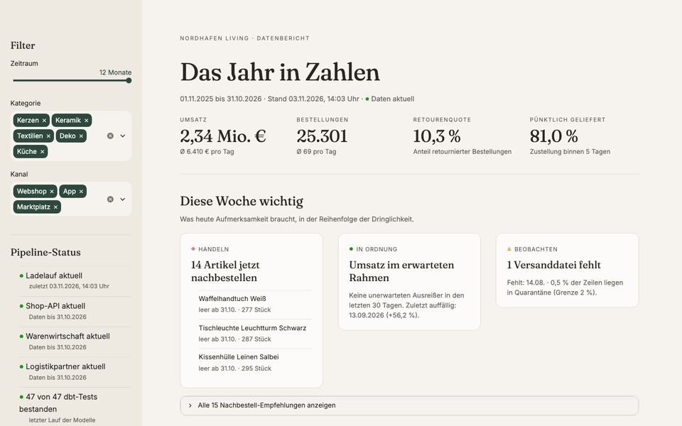
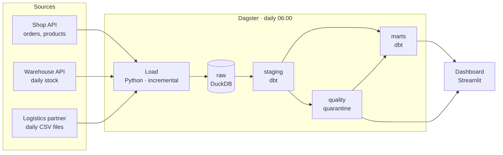
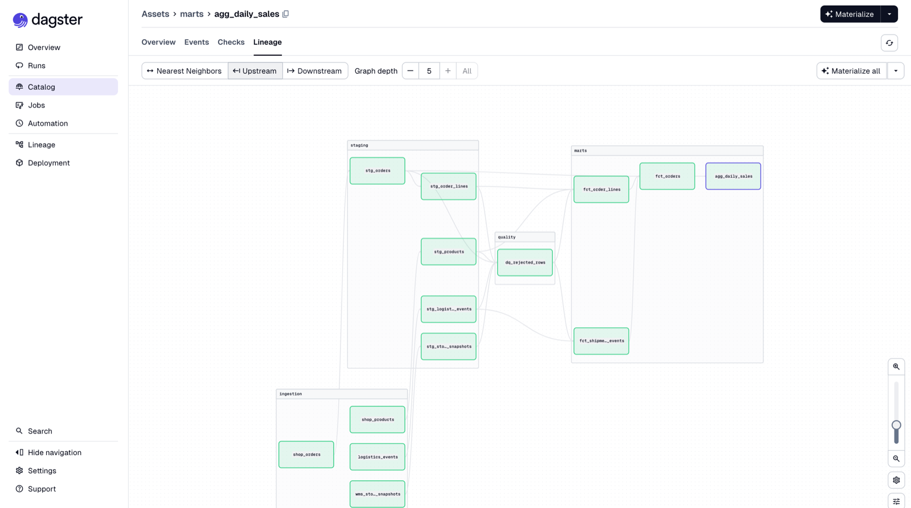
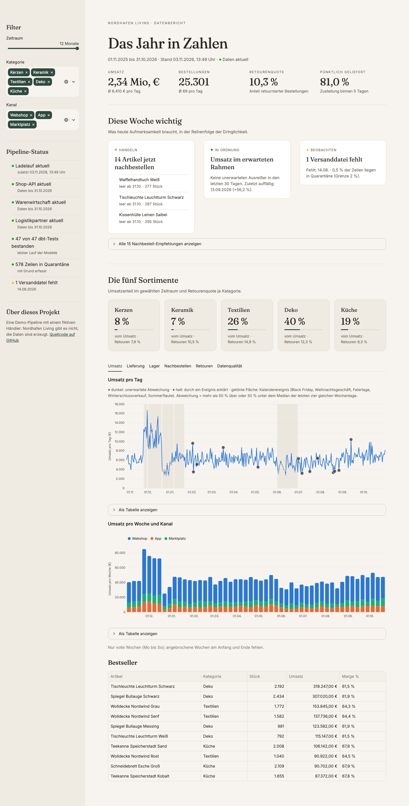
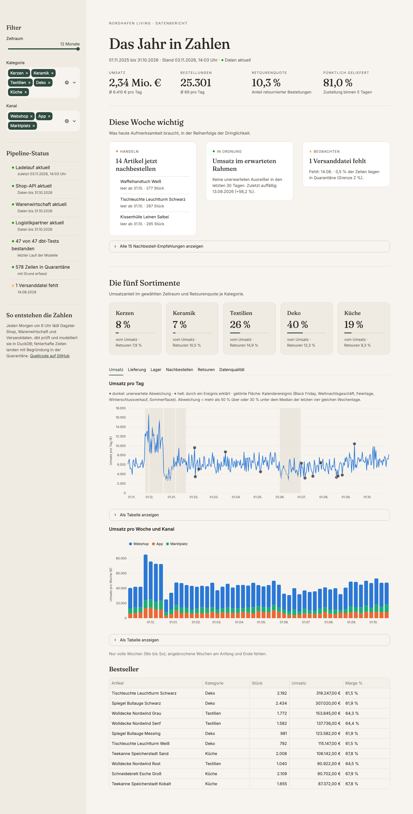
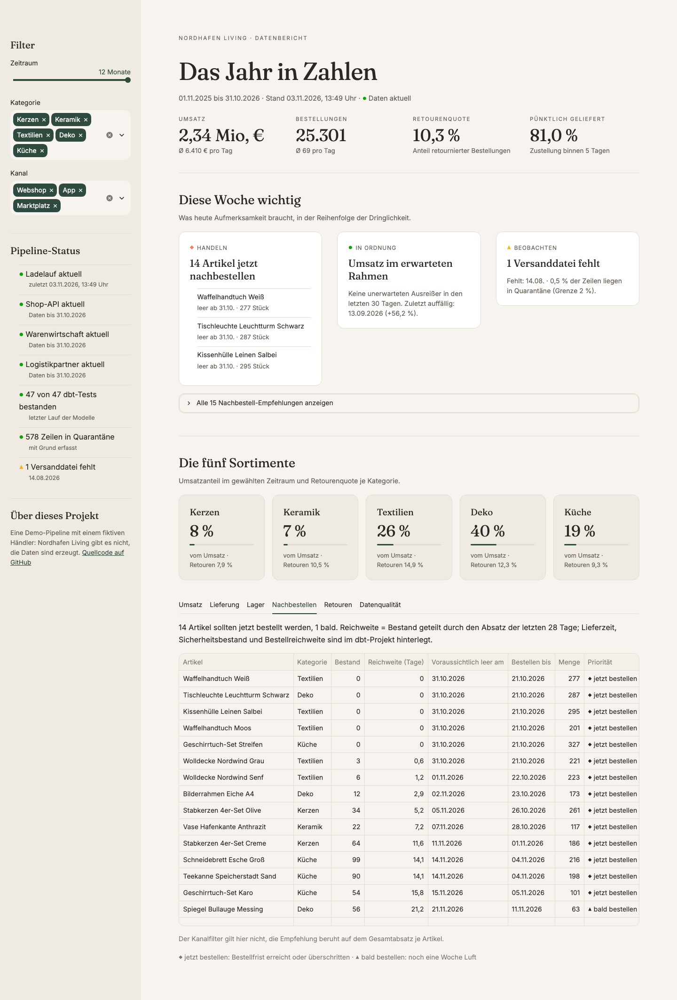
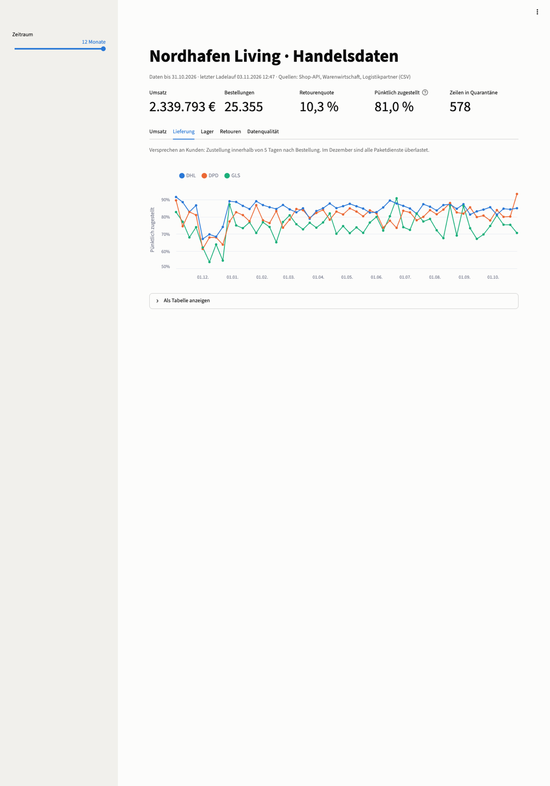
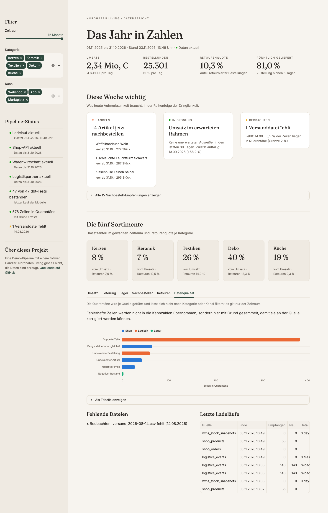

# Retail Data Pipeline

[](https://github.com/omaraldulimay/retail-data-pipeline/actions/workflows/ci.yml)

A daily data pipeline for an online retailer. Orders, stock levels and shipping events from three different
systems are loaded every morning, checked for errors, turned into reporting tables with dbt and shown in a
dashboard. Faulty rows are not silently dropped or let through – they are quarantined with a reason, so
someone can fix the source.

**Demo:** [30-second video](docs/demo.mp4) · [project page](https://omaraldulimay.github.io/projekte/retail-data-pipeline.html)



[Watch in full quality (MP4)](docs/demo.mp4)

## The problem

A typical mid-sized retailer has its data spread over systems that were never designed to work together: a
shop API, a warehouse system and CSV files from a logistics partner. Reports built directly on that data are
wrong in quiet ways – duplicated rows, unknown articles, a partner who suddenly changes the date format, a
file that never arrives. This project shows how to get from that reality to numbers people can trust.

The retailer is fictional (*Nordhafen Living*, home and lifestyle goods from Hamburg). The data covers one
year (Nov 2025 – Oct 2026) and is generated with realistic patterns and realistic problems.

## What it does

| Step | What happens |
|---|---|
| **Generate** | One year of orders (~26,000), daily stock snapshots and 364 logistics CSV files, with seasonality (Black Friday, Christmas, January sale, summer dip) and deliberately injected errors |
| **Load** | Python extractors pull the shop and warehouse APIs (cursor-based paging, retries with backoff) and pick up new CSV files. Every load is incremental and safe to repeat |
| **Store raw** | Data lands unchanged in DuckDB, so every number can be traced back to what a source delivered |
| **Check** | dbt rules move broken rows into quarantine: zero or negative quantities, unknown articles, negative prices, negative stock, duplicate rows, unknown order numbers |
| **Model** | dbt builds clean staging tables and reporting tables: daily sales, delivery performance per carrier, stock coverage, return rates |
| **Recommend** | `rec_reorder` lists SKUs to reorder with date and quantity (lead time, safety stock and order cover are dbt vars); `alert_sales_anomalies` flags days far from the median of the same weekday in the 4 weeks before and marks the ones that a calendar event explains (seed `calendar_events`: Black Friday, Christmas, holidays, sale, summer dip) as expected |
| **Orchestrate** | Dagster runs everything daily at 06:00, shows lineage and run history, checks for missing files, too many rejected rows, stale sources and an unexpected revenue anomaly on the latest day, and sends failures to a chat webhook |
| **Show** | A Streamlit dashboard with sales, delivery, stock, returns and data quality |

### Problems the pipeline handles

- **Duplicates** – the logistics partner repeats rows; the shop sends the same order twice.
- **Changing formats** – the partner switched from `2026-05-31 14:05` to `01.06.2026 14:05` on 1 June. Both are parsed.
- **Windows encoding** – CSVs arrive in `cp1252` with semicolons, as German partners usually send them.
- **Late changes** – cancelled orders arrive as a new version; only the latest version counts.
- **Missing data** – the file for 14 August never arrives; Dagster flags the gap.
- **Unreliable APIs** – with 20 % of requests failing, all data still arrives (retries with exponential backoff and jitter).
- **Corrected re-deliveries** – a file re-sent under the same name with new content replaces the old rows.
- **Backfill** – one day's logistics file can be force-reloaded (`--reload-day` or the `reload_logistics_day` Dagster job), even if its checksum is unchanged.
- **Stale sources** – a Dagster check warns when a source lags the others by more than a day or the last load is older than `FRESHNESS_HOURS`.

The quarantine finds exactly the errors the generator injected – the test suite checks this.

## Architecture





Every dbt test shows up in Dagster as a check on the table it guards, next to four Python checks: *every daily
file arrived*, *at most 2 % of a source's rows are quarantined*, *sources are fresh* and *the latest day is
no unexpected revenue anomaly* (the last two only warn).

## Quick start

### With Docker

```bash
docker compose up --build
```

The first start generates the data and runs the pipeline once (about a minute). Then open:

- Dashboard: <http://localhost:8501>
- Dagster (lineage, runs, schedule): <http://localhost:3000>

### Without Docker

Requires Python 3.12.

```bash
python3.12 -m venv .venv && source .venv/bin/activate
pip install -e ".[dev]"

python -m generator.generate                                       # one year of source data
dagster job execute -m orchestration.definitions -j daily_pipeline  # load, check, model (~40 s)
streamlit run dashboard/app.py                                      # dashboard
dagster dev                                                         # optional: Dagster UI
python -m pipeline.run --reload-day 2026-08-13                      # force-reload one logistics day, then run dbt build
```

By default the mock source APIs run inside the pipeline process. To run them as a separate service, start
`uvicorn sources.app:app --port 8100` and set `SOURCE_API_URL=http://127.0.0.1:8100`.

## Deployment to Azure

The `infra/` folder holds a Terraform setup that is ready to deploy. It is validated with
`terraform validate` in CI but has not been applied, so nothing is running yet.

- A Container App Job runs `python -m pipeline.cloud run` daily at 05:00 UTC (about 06:00 in Berlin).
- The DuckDB file lives in a private blob container: the job downloads it, runs the pipeline and uploads it.
- The dashboard is a Container App that scales to zero and refreshes the file at most every 15 minutes.
- A user-assigned managed identity with *Storage Blob Data Contributor* replaces keys and passwords.
- CI publishes the Docker image to `ghcr.io/omaraldulimay/retail-data-pipeline`.

See [infra/README.md](infra/README.md) for deploy steps and costs.

## Deploy the dashboard to Streamlit Community Cloud

The dashboard can run on its own without Dagster or a `data/` folder: when the warehouse is missing, it
generates the sources, loads them in process and runs `dbt build` once (about a minute), then shows the
data. Building is slow on the Cloud CPUs, so the dashboard first downloads the warehouse that CI builds on
every push to `main` (release `demo-data`, override the URL with `DEMO_WAREHOUSE_URL`, empty disables it)
and only falls back to building it if the download fails. `requirements.txt` contains `-e .`, an editable install, so paths resolve to the cloned repo.

1. Open [share.streamlit.io](https://share.streamlit.io) and sign in with GitHub.
2. Click **New app** and choose the repository `omaraldulimay/retail-data-pipeline`, branch `main`, main
   file `dashboard/app.py`.
3. **Important:** under **Advanced settings** choose **Python 3.12**. The version is set there, not in a
   file, and the default can be newer (3.14 hangs the first build). The app shows an error and
   `pip install` fails on anything but 3.12. A wrong version cannot be changed later: delete the
   app and create it again.
4. Optional: Streamlit Cloud is detected automatically (the repo is mounted at `/mount/src/`). To force the
   build elsewhere, set the secret `DEMO_BOOTSTRAP = "1"` (see `.streamlit/secrets.toml.example`).
5. Click **Deploy**. Afterwards open **Settings → Sharing** and set the app to **public**, otherwise
   visitors must sign in. The first visit builds the data; later visits are instant until the container restarts.

Locally nothing changes: without `DEMO_BOOTSTRAP=1` the dashboard expects a warehouse from the pipeline.

## Dashboard



| Sales with calendar events | Reorder recommendations |
|---|---|
|  |  |

| Delivery performance per carrier | Data quality and quarantine |
|---|---|
|  |  |

The numbers tell a story: DHL delivers on time most often, GLS least; in December every carrier misses the
5-day promise more often; textiles are returned most, mostly because the colour looks different on screen.

## Configuration

| Variable | Default | Purpose |
|---|---|---|
| `WAREHOUSE_PATH` | `data/warehouse.duckdb` | DuckDB file |
| `SOURCES_DIR` | `data/sources` | Generated source data and the CSV drop folder |
| `SOURCE_API_URL` | *(unset: in-process)* | URL of the source APIs |
| `SOURCE_FAILURE_RATE` | `0` | Make the mock APIs fail randomly (0–1) |
| `MAX_REJECTED_SHARE` | `0.02` | Quarantine share that fails the quality check |
| `FRESHNESS_HOURS` | `26` | Age of the last successful load that fails the freshness check |
| `ALERT_WEBHOOK_URL` | *(unset)* | Teams/Slack webhook for failed runs |

## Testing

```bash
pytest -q                          # 63 tests, ~5 min
ruff check . && ruff format --check .
```

- **Generator** – deterministic output, injected errors present, seasonality.
- **HTTP** – retries on 503 and connection errors, no retry on 404, backoff timing.
- **Extraction** – exact counts, idempotent reruns, resume after an interrupted run, 30 % API failures,
  changed and new CSV files, new order versions, single-day reload.
- **dbt end to end** – builds the warehouse in a temp folder and checks that the quarantine counts equal the
  injected errors, that the missing day is detected and that reports contain only valid rows.
- **CI** runs lint and tests, then builds the Docker image, runs the daily job inside it and checks the
  result with `python -m pipeline.check`.

## Design decisions

- **DuckDB instead of a database server.** The workload is analytical: large scans, aggregations, a few
  writers. DuckDB is built for exactly that, needs no server and runs the same on a laptop and in CI. In a
  bigger setup the same dbt models would run on PostgreSQL, Snowflake or Fabric with a different profile.
- **Raw data stays raw.** Extractors never clean or drop anything. Cleaning happens in dbt, where every rule
  is visible SQL with a test, and the raw layer remains the evidence of what a source delivered.
- **Quarantine instead of silent filtering.** A rejected row keeps its reason. That turns data quality from a
  feeling into a number per source and rule – something to discuss with the partner who sends bad data.
- **Idempotent loads.** Order versions are keyed by content hash, files by name and checksum, snapshots by
  date and SKU. Rerunning any step never duplicates data, which is what makes retries and backfills safe.
- **Cursor saved per page.** An interrupted order load resumes where it stopped instead of starting over.
- **One writer at a time.** DuckDB allows a single writing process, so Dagster runs steps one after another
  in one process. For this data volume that is fast enough (about 40 s for a full year from scratch).

## Project structure

```
generator/        Deterministic test data with seasonality and injected errors
sources/          Mock shop and warehouse APIs (FastAPI)
pipeline/         Extractors, retry logic, warehouse schema, health check
dbt_project/      staging, quality (quarantine) and marts models with tests
orchestration/    Dagster assets, checks, schedule and failure alerts
dashboard/        Streamlit dashboard
tests/            Unit and end-to-end tests
```

## Possible next steps

- Run it in production on Azure and add alerting on failed job executions
- Incremental dbt models for the large fact tables once data grows beyond a few million rows
- Data contracts with the logistics partner instead of fixing formats after the fact
